  

  

  
  

### Sobre mí

Soy **Jean Pierre Perez (Shean)**, desarrollador de software en formación, interesado en construir aplicaciones útiles,
sistemas de gestión y soluciones de automatización.

Me gusta trabajar tanto en el desarrollo de software como en su despliegue, integrando APIs, bases de datos, servicios y
herramientas de infraestructura.

- Desarrollo asistentes de IA y automatizaciones con n8n, modelos de lenguaje y WhatsApp.
- Diseño **HOVIA**, un PMS para la gestión hotelera.
- Trabajo con Linux, Docker, servidores y servicios autohospedados.
- Desarrollo aplicaciones web, APIs y sistemas de gestión.
- Me interesan la arquitectura de software, la integración de servicios y las soluciones tecnológicas de bajo coste.

### Tecnologías y herramientas

| | |
|---|---|
| **Lenguajes** |       |
| **Backend y automatización** |     |
| **Infraestructura** |      |
| **IA e integraciones** |    |
| **Bases de datos** |   |

### Proyectos destacados

| Proyecto | Descripción |
|---|---|
| **Asistente personal con IA** | Asistente por WhatsApp para memoria, tareas, recordatorios y transcripción de audio. |
| **HOVIA** | PMS en desarrollo para la gestión de establecimientos hoteleros. |
| **Sistema de videovigilancia** | Streaming de cámara USB con FastAPI en Linux y acceso remoto. |
| **SIGCEU** | Propuesta de sistema para la gestión y coordinación de emergencias urbanas. |

#### Repositorios públicos

| Proyecto | Qué es | Stack |
|---|---|---|
| [discord-bot-de-musica](https://github.com/sheaan7/discord-bot-de-musica) | Bot de música para Discord | JavaScript |
| [Gestion-de-alquiler-de-vehiculos](https://github.com/sheaan7/Gestion-de-alquiler-de-vehiculos) | Gestión de alquiler de vehículos | TypeScript |
| [Gestion-de-clinica](https://github.com/sheaan7/Gestion-de-clinica) | Gestión de una clínica | Python |
| [Gestion-de-Pedidos](https://github.com/sheaan7/Gestion-de-Pedidos) | Gestión de pedidos | Python |
| [Sistema de gestión de inventario](https://github.com/sheaan7/Sistema-de-gesti-n-de-inventario-Node.js-) | Inventario con Node.js | JavaScript |

### Estadísticas

  
  

  

<picture>
  <source media="(prefers-color-scheme: dark)" srcset="https://raw.githubusercontent.com/sheaan7/sheaan7/output/github-snake-dark.svg" />
  <source media="(prefers-color-scheme: light)" srcset="https://raw.githubusercontent.com/sheaan7/sheaan7/output/github-snake.svg" />
  
</picture>

<i>Construir software funcional, integrar tecnologías y convertir ideas en sistemas que puedan utilizarse en escenarios reales.</i>

